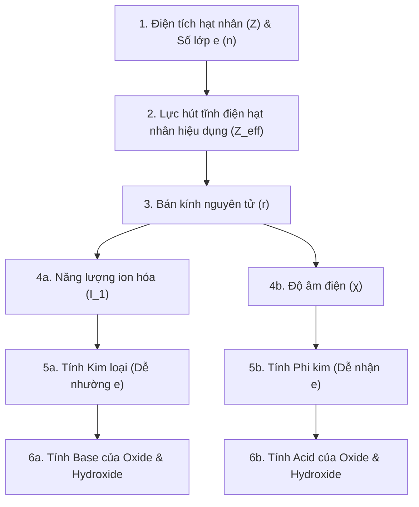

# Bài 6: Xu hướng biến đổi một số tính chất của nguyên tử các nguyên tố trong một chu kì và trong một nhóm
*(Sách giáo khoa Hoá học 10 – Bộ sách "Kết nối tri thức với cuộc sống", Chương 2, trang 35 – 40)*

---

## A. ĐỀ CƯƠNG TÓM TẮT LÝ THUYẾT TRỌNG TÂM

### I. CẤU HÌNH ELECTRON VÀ SỐ ELECTRON LỚP NGOÀI CÙNG
1. **Trong một chu kì:** 
   - Số lớp electron của nguyên tử các nguyên tố là **như nhau** (bằng số thứ tự chu kì).
   - Đi từ trái sang phải, điện tích hạt nhân ($Z$) tăng dần, số electron ở lớp ngoài cùng của nguyên tử các nguyên tố nhóm A **tăng dần từ 1 đến 8** (ở chu kì 1 từ 1 đến 2).
2. **Trong một nhóm A:** 
   - Số electron ở lớp ngoài cùng của các nguyên tử là **như nhau** (bằng số thứ tự nhóm A, trừ He có 2 electron nhưng xếp ở nhóm VIIIA).
   - Đi từ trên xuống dưới, điện tích hạt nhân tăng dần, **số lớp electron tăng dần**.

---

### II. BÁN KÍNH NGUYÊN TỬ
1. **Khái niệm:** Bán kính nguyên tử được xác định bằng một nửa khoảng cách giữa hai hạt nhân của hai nguyên tử cùng loại liên kết với nhau trong đơn chất (thường là bán kính cộng hóa trị). Đơn vị đo: picomet ($1\text{ pm} = 10^{-12}\text{ m}$) hoặc angstrom ($1\text{ \AA} = 10^{-10}\text{ m}$).
2. **Quy luật biến đổi bán kính nguyên tử:**
   - **Trong một chu kì (đi từ trái sang phải theo chiều tăng của điện tích hạt nhân $Z$):**
     + *Hiện tượng:* Bán kính nguyên tử **giảm dần**.
     + *Giải thích:* Các nguyên tử có **cùng số lớp electron**, nhưng điện tích hạt nhân $Z$ tăng dần làm cho lực hút tĩnh điện giữa hạt nhân với các electron lớp ngoài cùng tăng lên, kéo các electron lại gần hạt nhân hơn $\rightarrow$ bán kính nguyên tử co lại, giảm dần.
   - **Trong một nhóm A (đi từ trên xuống dưới theo chiều tăng của điện tích hạt nhân $Z$):**
     + *Hiện tượng:* Bán kính nguyên tử **tăng dần**.
     + *Giải thích:* Mặc dù điện tích hạt nhân tăng, nhưng **số lớp electron tăng dần** và hiệu ứng chắn của các lớp electron bên trong tăng lên, làm giảm lực hút của hạt nhân đối với các electron lớp ngoài cùng $\rightarrow$ bán kính nguyên tử tăng dần.
3. **So sánh bán kính của nguyên tử với ion tương ứng:**
   - **Bán kính Cation nhỏ hơn bán kính nguyên tử kim loại tương ứng:** $r_{M^{n+}} < r_M$ (Do mất bớt electron lớp ngoài cùng, số lớp electron giảm hoặc lực hút của hạt nhân lên các electron còn lại mạnh hơn).
     *Ví dụ:* $r_{\text{Na}^+} < r_{\text{Na}}$.
   - **Bán kính Anion lớn hơn bán kính nguyên tử phi kim tương ứng:** $r_{X^{m-}} > r_X$ (Do nhận thêm electron, lực đẩy giữa các electron tăng làm đám mây electron phình to ra).
     *Ví dụ:* $r_{\text{Cl}^-} > r_{\text{Cl}}$.

---

### III. ĐỘ ÂM ĐIỆN (ELECTRONEGATIVITY)
1. **Khái niệm:** 
   - Độ âm điện ($\chi$) của một nguyên tử là đại lượng đặc trưng cho **khả năng hút electron** của nguyên tử đó khi hình thành liên kết hoá học.
   - Thường sử dụng thang đo độ âm điện của **L. Pauling** (dao động từ 0,7 đến 3,98).
2. **Quy luật biến đổi độ âm điện:**
   - **Trong một chu kì (từ trái sang phải theo chiều tăng của $Z$):**
     + Độ âm điện nói chung **tăng dần**.
     + *Giải thích:* Bán kính nguyên tử giảm, điện tích hạt nhân tăng làm tăng khả năng hút cặp electron liên kết về phía mình.
   - **Trong một nhóm A (từ trên xuống dưới theo chiều tăng của $Z$):**
     + Độ âm điện nói chung **giảm dần**.
     + *Giải thích:* Số lớp electron tăng, bán kính nguyên tử tăng làm giảm lực hút của hạt nhân đối với cặp electron liên kết.
3. **Nguyên tố cực trị về độ âm điện:**
   - Nguyên tố có độ âm điện **lớn nhất**: **Fluorine** ($\text{F}, \chi = 3,98 \approx 4,0$).
   - Nguyên tố có độ âm điện **nhỏ nhất**: **Cesium** ($\text{Cs}, \chi = 0,79$) hoặc **Francium** ($\text{Fr}, \chi = 0,7$).

---

### IV. TÍNH KIM LOẠI VÀ TÍNH PHI KIM
1. **Khái niệm:**
   - **Tính kim loại:** Là tính chất của một nguyên tố mà nguyên tử của nó **dễ nhường electron** để trở thành ion dương (cation):
     $$M \rightarrow M^{n+} + ne$$
     Nguyên tử càng dễ nhường electron thì tính kim loại càng mạnh (tính khử càng mạnh).
   - **Tính phi kim:** Là tính chất của một nguyên tố mà nguyên tử của nó **dễ nhận electron** để trở thành ion âm (anion):
     $$X + me \rightarrow X^{m-}$$
     Nguyên tử càng dễ nhận electron thì tính phi kim càng mạnh (tính oxi hoá càng mạnh).
2. **Quy luật biến đổi:**
   - **Trong một chu kì (đi từ trái sang phải theo chiều $Z$ tăng):**
     + **Tính kim loại giảm dần**, đồng thời **tính phi kim tăng dần**.
     + *Giải thích:* Bán kính nguyên tử giảm và độ âm điện tăng $\rightarrow$ khả năng nhường electron giảm dần (tính kim loại giảm), khả năng nhận electron tăng dần (tính phi kim tăng).
     + *Ví dụ chu kì 3:* Bắt đầu bằng kim loại kiềm mạnh ($\text{Na}$), chuyển sang kim loại yếu hơn ($\text{Mg, Al}$), rồi đến phi kim ($\text{Si, P, S}$), kết thúc bằng halogen phi kim rất mạnh ($\text{Cl}$) và khí hiếm ($\text{Ar}$).
   - **Trong một nhóm A (đi từ trên xuống dưới theo chiều $Z$ tăng):**
     + **Tính kim loại tăng dần**, đồng thời **tính phi kim giảm dần**.
     + *Giải thích:* Số lớp electron tăng, bán kính nguyên tử tăng, các electron ngoài cùng liên kết lỏng lẻo với hạt nhân $\rightarrow$ nguyên tử càng dễ nhường electron (tính kim loại tăng), càng khó hút/nhận thêm electron (tính phi kim giảm).
     + *Ví dụ nhóm IA:* Tính kim loại tăng dần: $\text{Li} < \text{Na} < \text{K} < \text{Rb} < \text{Cs}$.
     + *Ví dụ nhóm VIIA:* Tính phi kim giảm dần: $\text{F} > \text{Cl} > \text{Br} > \text{I}$.
3. **Tổng kết quy luật cực trị:**
   - Kim loại mạnh nhất trong bảng tuần hoàn: **Cesium (Cs)** (hoặc nguyên tố phóng xạ Francium).
   - Phi kim mạnh nhất trong bảng tuần hoàn: **Fluorine (F)**.

---

### BẢNG TỔNG KẾT QUY LUẬT TUẦN HOÀN BÀI 6 (CHI TIẾT VÀ ĐẦY ĐỦ NHẤT)

#### 1. Bảng quy luật biến đổi các đặc trưng và tính chất nguyên tử

| STT | Đại lượng / Tính chất | Trong một chu kì (Chiều từ Trái $\rightarrow$ Phải) | Bản chất / Nguyên nhân giải thích (Chu kì) | Trong một nhóm A (Chiều từ Trên $\downarrow$ Dưới) | Bản chất / Nguyên nhân giải thích (Nhóm A) | Giá trị Cực trị trong BTH |
| :-: | :--- | :---: | :--- | :---: | :--- | :---: |
| **1** | **Điện tích hạt nhân ($Z$)** | **Tăng dần** | Số proton tăng từ $Z$ lên $Z+1$ qua mỗi ô nguyên tố. | **Tăng dần** | Số proton tăng vọt qua từng chu kì. | $\text{H} (Z=1)$ bé nhất; $\text{Og} (Z=118)$ lớn nhất |
| **2** | **Số lớp electron ($n$)** | **Không đổi** | Bằng đúng số thứ tự của chu kì (cùng số lớp electron). | **Tăng dần** | Mỗi chu kì mới bắt đầu bằng việc điền electron vào một lớp mới ($n$ tăng). | Chu kì 1 (1 lớp); Chu kì 7 (7 lớp) |
| **3** | **Số electron lớp ngoài cùng** | **Tăng dần** (từ 1 đến 8) | Electron điền dần vào các phân lớp $s, p$ lớp ngoài cùng (nhóm IA $\rightarrow$ VIIIA). | **Không đổi** | Có cấu hình electron lớp ngoài cùng tương tự nhau ($ns^x np^y$). | $1e$ (nhóm IA); $8e$ (nhóm VIIIA, trừ He có $2e$) |
| **4** | **Lực hút hạt nhân lên e ngoài cùng ($Z_{eff}$)** | **Tăng mạnh** | $Z$ tăng nhưng số lớp $e$ không đổi $\rightarrow$ điện tích hạt nhân hiệu dụng tăng mạnh. | **Giảm dần** | Mặc dù $Z$ tăng nhưng số lớp $e$ bên trong tăng gây hiệu ứng chắn (shielding effect) mạnh. | Càng về bên phải càng hút mạnh |
| **5** | **Bán kính nguyên tử ($r$)** | **GIẢM DẦN** | Cùng số lớp electron nhưng $Z_{eff}$ tăng làm hạt nhân kéo mây electron lại gần tâm hơn. | **TĂNG DẦN** | Số lớp electron tăng dần, electron ngoài cùng xa hạt nhân và bị các lớp trong chắn lực hút. | **Lớn nhất:** $\text{Cs}$ (hoặc $\text{Fr}$) **Nhỏ nhất:** $\text{He}$ (hoặc $\text{F}$) |
| **6** | **Năng lượng ion hóa thứ nhất ($I_1$)** | **TĂNG DẦN** (nói chung) | Bán kính giảm, $Z_{eff}$ tăng $\rightarrow$ electron ngoài cùng liên kết rất chặt, cần nhiều năng lượng để bứt $e$. | **GIẢM DẦN** | Bán kính tăng, electron ngoài cùng liên kết lỏng lẻo với hạt nhân $\rightarrow$ rất dễ bị bứt ra. | **Lớn nhất:** $\text{He}$ **Nhỏ nhất:** $\text{Cs}$ (hoặc $\text{Fr}$) |
| **7** | **Độ âm điện ($\chi$)** | **TĂNG DẦN** | Bán kính nguyên tử giảm, điện tích hạt nhân tăng $\rightarrow$ khả năng hút cặp electron liên kết càng mạnh. | **GIẢM DẦN** | Bán kính nguyên tử tăng, lực hút của hạt nhân lên cặp electron dùng chung bị suy yếu. | **Lớn nhất:** $\text{F}$ ($\chi \approx 3,98$) **Nhỏ nhất:** $\text{Cs}$ ($\chi = 0,79$) |
| **8** | **Tính kim loại (Tính khử / Khả năng nhường e)** | **GIẢM DẦN** | Lực hút của hạt nhân tăng, bán kính giảm $\rightarrow$ nguyên tử càng **khó nhường electron**. | **TĂNG DẦN** | Số lớp $e$ tăng, bán kính tăng $\rightarrow$ electron ngoài cùng liên kết lỏng lẻo, nguyên tử càng **dễ nhường e**. | **Kim loại mạnh nhất:** $\text{Cs}$ (không tính nguyên tố phóng xạ) |
| **9** | **Tính phi kim (Tính oxi hóa / Khả năng nhận e)** | **TĂNG DẦN** | Lực hút hạt nhân tăng, bán kính giảm $\rightarrow$ nguyên tử càng **dễ thu/nhận electron**. | **GIẢM DẦN** | Bán kính tăng, lực hút hạt nhân yếu $\rightarrow$ nguyên tử càng **khó thu/nhận thêm electron**. | **Phi kim mạnh nhất:** $\text{F}$ (Fluorine) |
| **10** | **Bán kính ion so với nguyên tử** | • $r_{\text{cation}} < r_{\text{nguyên tử}}$: Mất bớt $e$, lớp $e$ giảm hoặc $Z/e$ tăng $\rightarrow$ hạt nhân hút chặt hơn. • $r_{\text{anion}} > r_{\text{nguyên tử}}$: Nhận thêm $e$, lực đẩy electron tăng $\rightarrow$ đám mây phình to. • Dãy đẳng electron: $Z$ càng lớn thì bán kính ion càng nhỏ ($r_{\text{Al}^{3+}} < r_{\text{Mg}^{2+}} < r_{\text{Na}^+} < r_{\text{F}^-} < r_{\text{O}^{2-}}$). | | | | |

---

#### 2. Bảng mở rộng: Mối liên hệ tuần hoàn sang hợp chất của nguyên tố (Bài 6 & 7)

| Đại lượng / Tính chất hợp chất | Trong một chu kì (Chiều từ Trái $\rightarrow$ Phải) | Trong một nhóm A (Chiều từ Trên $\downarrow$ Dưới) | Ví dụ minh họa điển hình (Chu kì 3 / Nhóm IA / Nhóm VIIA) |
| :--- | :---: | :---: | :--- |
| **Hóa trị cao nhất trong Oxide** | **Tăng dần từ I $\rightarrow$ VII** (= STT nhóm A) | Không đổi (= STT nhóm A) | $\text{Na}_2\text{O}^{\text{I}} \rightarrow \text{Mg}\text{O}^{\text{II}} \rightarrow \text{Al}_2\text{O}_3^{\text{III}} \rightarrow \text{Si}\text{O}_2^{\text{IV}} \rightarrow \text{P}_2\text{O}_5^{\text{V}} \rightarrow \text{S}\text{O}_3^{\text{VI}} \rightarrow \text{Cl}_2\text{O}_7^{\text{VII}}$ |
| **Hóa trị với Hydrogen (Phi kim)** | **Giảm dần từ IV $\rightarrow$ I** ($= 8 - \text{STT nhóm}$) | Không đổi | $\text{SiH}_4^{\text{IV}} \rightarrow \text{PH}_3^{\text{III}} \rightarrow \text{H}_2\text{S}^{\text{II}} \rightarrow \text{HCl}^{\text{I}}$ |
| **Tính Base của Oxide cao nhất** | **Giảm dần** | **Tăng dần** | $\text{Na}_2\text{O}$ (kiềm mạnh) $\rightarrow \text{MgO}$ (base yếu) $\rightarrow \text{Al}_2\text{O}_3$ (lưỡng tính) |
| **Tính Acid của Oxide cao nhất** | **Tăng dần** | **Giảm dần** | $\text{SiO}_2$ (acid rất yếu) $\rightarrow \text{P}_2\text{O}_5 \rightarrow \text{SO}_3 \rightarrow \text{Cl}_2\text{O}_7$ (acid rất mạnh) |
| **Tính Base của Hydroxide tương ứng** | **Giảm dần** | **Tăng dần** | $\text{NaOH}$ (base mạnh) $\rightarrow \text{Mg(OH)}_2$ (base yếu) $\rightarrow \text{Al(OH)}_3$ (lưỡng tính) |
| **Tính Acid của Hydroxide tương ứng** | **Tăng dần** | **Giảm dần** | $\text{H}_2\text{SiO}_3$ (rất yếu) $\rightarrow \text{H}_3\text{PO}_4$ (TB) $\rightarrow \text{H}_2\text{SO}_4$ (mạnh) $\rightarrow \text{HClO}_4$ (rất mạnh) |

---

#### 3. Quy tắc ghi nhớ nhanh & Sơ đồ hai nhóm đại lượng đối lập

Để không bao giờ bị nhầm lẫn dấu chiều tăng/giảm trong các bài kiểm tra, hãy nhớ nguyên tắc **"Hai phe đối lập"**:

* **Nhóm 1 — "Phe Tăng theo Chu kì" (Đồng biến với Tính Phi kim):**
  $$\text{Độ âm điện } (\chi) \sim \text{Tính phi kim} \sim \text{Năng lượng ion hóa } (I_1) \sim \text{Tính acid của hợp chất}$$
  $\rightarrow$ Trong một chu kì: **TĂNG DẦN**.  
  $\rightarrow$ Trong một nhóm A: **GIẢM DẦN**.

* **Nhóm 2 — "Phe Giảm theo Chu kì" (Đồng biến với Tính Kim loại):**
  $$\text{Bán kính nguyên tử } (r) \sim \text{Tính kim loại} \sim \text{Tính base của hợp chất}$$
  $\rightarrow$ Trong một chu kì: **GIẢM DẦN**.  
  $\rightarrow$ Trong một nhóm A: **TĂNG DẦN**.

* **Quy tắc hai góc cực trị của Bảng tuần hoàn:**
  * **Góc Đông Bắc (Phía trên, bên phải):** Đỉnh cao của **Phi kim** $\rightarrow$ Nguyên tố **$\text{F}$ (Fluorine)** có độ âm điện lớn nhất ($\chi = 3,98$), tính phi kim mạnh nhất.
  * **Góc Tây Nam (Phía dưới, bên trái):** Đỉnh cao của **Kim loại** $\rightarrow$ Nguyên tố **$\text{Cs}$ (Cesium)** có bán kính nguyên tử lớn nhất, độ âm điện nhỏ nhất ($\chi = 0,79$), tính kim loại mạnh nhất.

---

#### 4. Bản chất & Chuỗi liên hệ nhân – quả giữa từng đại lượng

Mọi quy luật tuần hoàn không tồn tại độc lập mà liên kết chặt chẽ theo một **chuỗi nhân – quả dây chuyền (Domino Effect)** bắt nguồn từ cấu tạo nguyên tử:

##### Chi tiết mối liên hệ giữa từng cặp đại lượng:

1. **Mối liên hệ giữa $(Z, n) \longrightarrow$ Lực hút hạt nhân hiệu dụng ($Z_{eff}$) $\longrightarrow$ Bán kính ($r$):**
   * *Trong chu kì:* Số lớp $n$ không đổi, $Z$ tăng $\rightarrow$ Lực hút tĩnh điện giữa hạt nhân và electron ngoài cùng tăng mạnh $\rightarrow$ Mây electron bị kéo siết chặt về phía tâm $\rightarrow$ **Bán kính nguyên tử $r$ giảm**.
   * *Trong nhóm A:* Số lớp $n$ tăng $\rightarrow$ Các lớp electron bên trong chắn lực hút của hạt nhân (hiệu ứng chắn) $\rightarrow$ Lực hút lên electron lớp ngoài cùng giảm $\rightarrow$ **Bán kính nguyên tử $r$ tăng**.

2. **Mối liên hệ giữa Bán kính ($r$) $\longrightarrow$ Năng lượng ion hóa ($I_1$) & Độ âm điện ($\chi$):**
   * Định luật Coulomb: $F = k \cdot \frac{|q_1 \cdot q_2|}{r^2}$ (Lực hút tỉ lệ nghịch với bình phương khoảng cách $r$).
   * **Khi bán kính $r$ càng nhỏ:** Electron ở rất sát hạt nhân $\rightarrow$ Lực hút cực mạnh:
     * Muốn bứt electron ra ngoài cần năng lượng rất lớn $\rightarrow$ **Năng lượng ion hóa $I_1$ càng cao** ($I_1$ tỉ lệ nghịch với $r$).
     * Hạt nhân hút mạnh cặp electron dùng chung trong liên kết $\rightarrow$ **Độ âm điện $\chi$ càng lớn** ($\chi$ tỉ lệ nghịch với $r$).
   * **Khi bán kính $r$ càng lớn:** Electron ở xa hạt nhân $\rightarrow$ Lực giữ lỏng lẻo $\rightarrow$ **$I_1$ càng nhỏ** và **$\chi$ càng nhỏ**.

3. **Mối liên hệ giữa Bán kính ($r$), Năng lượng ion hóa ($I_1$), Độ âm điện ($\chi$) $\longrightarrow$ Tính Kim loại & Phi kim:**
   * **Tính Kim loại (Xu hướng nhường electron):**
     * Nguyên tử càng dễ nhường electron khi: Bán kính $r$ càng **lớn**, lực giữ $e$ càng **yếu** (năng lượng ion hóa $I_1$ càng **thấp**), và độ âm điện $\chi$ càng **nhỏ**.
     * $\Rightarrow$ **Tính kim loại tỉ lệ thuận với $r$; tỉ lệ nghịch với $I_1$ và $\chi$.**
   * **Tính Phi kim (Xu hướng nhận electron):**
     * Nguyên tử càng dễ thu/hút electron khi: Bán kính $r$ càng **nhỏ**, lực hút hạt nhân càng **mạnh**, độ âm điện $\chi$ càng **lớn**, và $I_1$ càng **lớn**.
     * $\Rightarrow$ **Tính phi kim tỉ lệ thuận với $\chi$ và $I_1$; tỉ lệ nghịch với $r$.**

4. **Mối liên hệ giữa Tính Kim loại / Phi kim $\longrightarrow$ Tính Acid / Base của Hợp chất:**
   * Trong hợp chất hydroxide có liên kết dạng: $R - O - H$.
   * **Nếu $R$ là kim loại mạnh** ($r$ lớn, $\chi$ nhỏ):
     * Nguyên tử $R$ dễ nhường mật độ electron cho $O$, liên kết $R-O$ mang tính ion và rất dễ bị phân cắt theo kiểu:
       $$R - O - H \longrightarrow R^+ + OH^- \quad \Longrightarrow \text{Thể hiện TÍNH BASE MẠNH}$$
     * $\Rightarrow$ **Kim loại càng mạnh $\longrightarrow$ Oxide và Hydroxide có tính base càng mạnh.**
   * **Nếu $R$ là phi kim mạnh** ($r$ nhỏ, $\chi$ lớn):
     * Nguyên tử $R$ hút mạnh mật độ electron về phía mình, làm liên kết $R-O$ bền chắc, đồng thời kéo mây electron của liên kết $O-H$ phân cực mạnh về phía $O$, khiến liên kết $O-H$ dễ bị đứt theo kiểu:
       $$R - O - H \longrightarrow RO^- + H^+ \quad \Longrightarrow \text{Thể hiện TÍNH ACID MẠNH}$$
     * $\Rightarrow$ **Phi kim càng mạnh $\longrightarrow$ Oxide và Hydroxide có tính acid càng mạnh.**

5. **Mối liên hệ giữa Bán kính nguyên tử ($r$) và Bán kính ion ($r_{\text{ion}}$):**
   * Khi tạo **Cation** ($M \rightarrow M^{n+} + ne$): Nguyên tử kim loại mất electron ngoài cùng, số lớp electron giảm hoặc tỉ số $Z/e$ tăng $\rightarrow$ Lực hút hạt nhân lên các electron còn lại mạnh hơn $\rightarrow \mathbf{r_{\text{cation}} < r_{\text{nguyên tử}}}$.
   * Khi tạo **Anion** ($X + me \rightarrow X^{m-}$): Nguyên tử phi kim nhận thêm electron, điện tích hạt nhân giữ nguyên nhưng lực đẩy giữa các electron tăng lên $\rightarrow$ Mây electron phình to ra $\rightarrow \mathbf{r_{\text{anion}} > r_{\text{nguyên tử}}}$.
   * Dãy đẳng electron: Cùng số electron, hạt nhân nào có $Z$ lớn hơn sẽ hút mạnh hơn $\rightarrow$ Bán kính nhỏ hơn:
     $$r_{\text{Al}^{3+}} (Z=13) < r_{\text{Mg}^{2+}} (Z=12) < r_{\text{Na}^+} (Z=11) < r_{\text{F}^-} (Z=9) < r_{\text{O}^{2-}} (Z=8) < r_{\text{N}^{3-}} (Z=7)$$

---

#### 5. Bảng ma trận tương quan chéo giữa các đại lượng

| Đại lượng xét | Bán kính ($r$) | Độ âm điện ($\chi$) | Năng lượng ion hóa ($I_1$) | Tính Kim loại | Tính Phi kim | Tính Base hợp chất | Tính Acid hợp chất |
| :--- | :---: | :---: | :---: | :---: | :---: | :---: | :---: |
| **Bán kính ($r$)** | — | **Nghịch** | **Nghịch** | **Thuận** | **Nghịch** | **Thuận** | **Nghịch** |
| **Độ âm điện ($\chi$)** | **Nghịch** | — | **Thuận** | **Nghịch** | **Thuận** | **Nghịch** | **Thuận** |
| **Năng lượng ion hóa ($I_1$)** | **Nghịch** | **Thuận** | — | **Nghịch** | **Thuận** | **Nghịch** | **Thuận** |
| **Tính Kim loại** | **Thuận** | **Nghịch** | **Nghịch** | — | **Nghịch** | **Thuận** | **Nghịch** |
| **Tính Phi kim** | **Nghịch** | **Thuận** | **Thuận** | **Nghịch** | — | **Nghịch** | **Thuận** |
| **Tính Base hợp chất** | **Thuận** | **Nghịch** | **Nghịch** | **Thuận** | **Nghịch** | — | **Nghịch** |
| **Tính Acid hợp chất** | **Nghịch** | **Thuận** | **Thuận** | **Nghịch** | **Thuận** | **Nghịch** | — |

*(Ghi chú: **Thuận** = Cùng tăng hoặc cùng giảm; **Nghịch** = Đại lượng này tăng thì đại lượng kia giảm).*

---

## B. HƯỚNG DẪN TRẢ LỜI CÂU HỎI VÀ BÀI TẬP SGK

### Câu hỏi 1 (SGK trang 36):
**Đề bài:** Dựa vào Bảng 6.1 (SGK), cho biết số electron lớp ngoài cùng của nguyên tử các nguyên tố: $\text{Li, Al, Ar, Ca, Si, Se, P, Bi}$.
* **Lời giải chi tiết:**
  - $\text{Li}$ ($Z = 3$, nhóm IA): có **1** electron lớp ngoài cùng.
  - $\text{Al}$ ($Z = 13$, nhóm IIIA): có **3** electron lớp ngoài cùng.
  - $\text{Ar}$ ($Z = 18$, nhóm VIIIA): có **8** electron lớp ngoài cùng (cấu hình bão hòa bền vững).
  - $\text{Ca}$ ($Z = 20$, nhóm IIA): có **2** electron lớp ngoài cùng.
  - $\text{Si}$ ($Z = 14$, nhóm IVA): có **4** electron lớp ngoài cùng.
  - $\text{Se}$ ($Z = 34$, nhóm VIA): có **6** electron lớp ngoài cùng.
  - $\text{P}$ ($Z = 15$, nhóm VA): có **5** electron lớp ngoài cùng.
  - $\text{Bi}$ ($Z = 83$, nhóm VA): có **5** electron lớp ngoài cùng.

---

### Câu hỏi 2 (SGK trang 36):
**Đề bài:** Nêu vị trí trong bảng tuần hoàn của các nguyên tố có $Z = 8; Z = 11; Z = 17$ và $Z = 20$.
* **Lời giải chi tiết:**
  1. **Nguyên tố $Z = 8$ (Oxygen - O):**
     - Cấu hình electron: $1\text{s}^2 2\text{s}^2 2\text{p}^4$.
     - Vị trí: Ô số **8** (do $Z = 8$), **chu kì 2** (có 2 lớp electron), **nhóm VIA** (nguyên tố p, có 6 electron lớp ngoài cùng).
  2. **Nguyên tố $Z = 11$ (Sodium - Na):**
     - Cấu hình electron: $1\text{s}^2 2\text{s}^2 2\text{p}^6 3\text{s}^1$.
     - Vị trí: Ô số **11**, **chu kì 3** (có 3 lớp electron), **nhóm IA** (nguyên tố s, có 1 electron lớp ngoài cùng).
  3. **Nguyên tố $Z = 17$ (Chlorine - Cl):**
     - Cấu hình electron: $1\text{s}^2 2\text{s}^2 2\text{p}^6 3\text{s}^2 3\text{p}^5$.
     - Vị trí: Ô số **17**, **chu kì 3** (có 3 lớp electron), **nhóm VIIA** (nguyên tố p, có 7 electron lớp ngoài cùng).
  4. **Nguyên tố $Z = 20$ (Calcium - Ca):**
     - Cấu hình electron: $1\text{s}^2 2\text{s}^2 2\text{p}^6 3\text{s}^2 3\text{p}^6 4\text{s}^2$.
     - Vị trí: Ô số **20**, **chu kì 4** (có 4 lớp electron), **nhóm IIA** (nguyên tố s, có 2 electron lớp ngoài cùng).

---

### Câu hỏi 3 (SGK trang 37):
**Đề bài:** Dựa vào bảng tuần hoàn, hãy so sánh và giải thích sự khác nhau về bán kính nguyên tử giữa:
a) $\text{Na}$ ($Z = 11$) và $\text{Cl}$ ($Z = 17$).
b) $\text{Li}$ ($Z = 3$) và $\text{K}$ ($Z = 19$).
* **Lời giải chi tiết:**
  - **a) So sánh $\text{Na}$ và $\text{Cl}$:**
    + Cả $\text{Na}$ và $\text{Cl}$ đều thuộc **chu kì 3** (có cùng 3 lớp electron).
    + Theo chiều tăng dần điện tích hạt nhân trong chu kì 3: $Z_{\text{Na}} = 11 < Z_{\text{Cl}} = 17$.
    + Hạt nhân của $\text{Cl}$ có điện tích lớn hơn nên hút các electron lớp ngoài cùng mạnh hơn $\rightarrow$ Bán kính nguyên tử của $\text{Na}$ lớn hơn $\text{Cl}$ ($r_{\text{Na}} > r_{\text{Cl}}$).
  - **b) So sánh $\text{Li}$ và $\text{K}$:**
    + Cả $\text{Li}$ và $\text{K}$ đều thuộc **nhóm IA**.
    + Đi từ trên xuống dưới trong nhóm IA: $\text{Li}$ ở chu kì 2 (có 2 lớp electron), $\text{K}$ ở chu kì 4 (có 4 lớp electron).
    + Nguyên tử $\text{K}$ có nhiều lớp electron hơn $\text{Li}$ $\rightarrow$ Bán kính nguyên tử của $\text{K}$ lớn hơn $\text{Li}$ ($r_{\text{K}} > r_{\text{Li}}$).

---

### Câu hỏi 4 (SGK trang 38):
**Đề bài:** Sắp xếp các nguyên tố sau theo thứ tự độ âm điện tăng dần: $\text{B, C, N, O, F}$ và $\text{F, Cl, Br, I}$.
* **Lời giải chi tiết:**
  - **Dãy $\text{B, C, N, O, F}$:**
    + Các nguyên tố này cùng thuộc **chu kì 2**, xếp theo chiều điện tích hạt nhân tăng dần ($Z = 5 \rightarrow 9$).
    + Trong một chu kì, đi từ trái sang phải, độ âm điện tăng dần:
      $$\chi_{\text{B}} < \chi_{\text{C}} < \chi_{\text{N}} < \chi_{\text{O}} < \chi_{\text{F}}$$
  - **Dãy $\text{F, Cl, Br, I}$:**
    + Các nguyên tố này cùng thuộc **nhóm VIIA** (halogen), xếp theo chiều tăng điện tích hạt nhân từ trên xuống dưới ($Z = 9 \rightarrow 53$).
    + Trong một nhóm A, đi từ trên xuống dưới, độ âm điện giảm dần. Sắp xếp theo chiều **tăng dần**:
      $$\chi_{\text{I}} < \chi_{\text{Br}} < \chi_{\text{Cl}} < \chi_{\text{F}}$$

---

### Câu hỏi 5 (SGK trang 40):
**Đề bài:** Cho các nguyên tố $\text{X} (Z = 12)$, $\text{Y} (Z = 19)$, $\text{T} (Z = 13)$. So sánh tính kim loại của $\text{X, Y, T}$.
* **Lời giải chi tiết:**
  - Viết cấu hình electron để xác định vị trí:
    + $\text{X} (Z = 12)$: $1\text{s}^2 2\text{s}^2 2\text{p}^6 3\text{s}^2 \rightarrow$ Chu kì 3, nhóm IIA ($\text{Mg}$).
    + $\text{T} (Z = 13)$: $1\text{s}^2 2\text{s}^2 2\text{p}^6 3\text{s}^2 3\text{p}^1 \rightarrow$ Chu kì 3, nhóm IIIA ($\text{Al}$).
    + $\text{Y} (Z = 19)$: $1\text{s}^2 2\text{s}^2 2\text{p}^6 3\text{s}^2 3\text{p}^6 4\text{s}^1 \rightarrow$ Chu kì 4, nhóm IA ($\text{K}$).
  - So sánh:
    + Trong cùng chu kì 3: đi từ trái sang phải, tính kim loại giảm: $\text{Mg (X)} > \text{Al (T)}$.
    + So sánh $\text{Mg (X)}$ nhóm IIA chu kì 3 với $\text{Na}$ nhóm IA chu kì 3: tính kim loại $\text{Na} > \text{Mg}$.
    + Trong nhóm IA: tính kim loại tăng từ trên xuống: $\text{K (Y)} > \text{Na} \rightarrow \text{K (Y)} > \text{Mg (X)}$.
  - Kết luận thứ tự tính kim loại giảm dần:
    $$\text{Y (K)} > \text{X (Mg)} > \text{T (Al)}$$

---

## C. BÀI TẬP TRẮC NGHIỆM CỦNG CỐ CÓ ĐÁP ÁN

**Câu 1:** Trong một chu kì, theo chiều tăng của điện tích hạt nhân, bán kính nguyên tử có xu hướng:
A. Tăng dần.  
B. Giảm dần.  
C. Không đổi.  
D. Biến đổi không theo quy luật.  
*Đáp án:* **B**. (Do cùng số lớp e nhưng điện tích hạt nhân tăng làm lực hút electron tăng).

**Câu 2:** Đại lượng đặc trưng cho khả năng hút electron của nguyên tử khi hình thành liên kết hoá học là:
A. Bán kính nguyên tử.  
B. Năng lượng ion hoá.  
C. Độ âm điện.  
D. Số khối.  
*Đáp án:* **C**.

**Câu 3:** Nguyên tố có độ âm điện lớn nhất trong bảng tuần hoàn là:
A. Cesium.  
B. Fluorine.  
C. Chlorine.  
D. Oxygen.  
*Đáp án:* **B** ($\chi \approx 3,98$).

**Câu 4:** Dãy nguyên tố nào sau đây được xếp theo chiều tính kim loại tăng dần?
A. $\text{Al, Mg, Na, K}$.  
B. $\text{K, Na, Mg, Al}$.  
C. $\text{Mg, Al, Na, K}$.  
D. $\text{Al, Na, Mg, K}$.  
*Đáp án:* **A**. (Trong chu kì 3: $\text{Al} < \text{Mg} < \text{Na}$; trong nhóm IA: $\text{Na} < \text{K}$).

**Câu 5:** Bán kính của các hạt $\text{Na, Na}^+, \text{Cl, Cl}^-$ được sắp xếp theo thứ tự giảm dần là:
A. $\text{Cl}^- > \text{Na} > \text{Cl} > \text{Na}^+$.  
B. $\text{Na} > \text{Cl} > \text{Cl}^- > \text{Na}^+$.  
C. $\text{Cl}^- > \text{Cl} > \text{Na} > \text{Na}^+$.  
D. $\text{Na} > \text{Na}^+ > \text{Cl}^- > \text{Cl}$.  
*Đáp án:* **A**. (Bán kính ion anion lớn hơn nguyên tử, cation nhỏ hơn nguyên tử).
