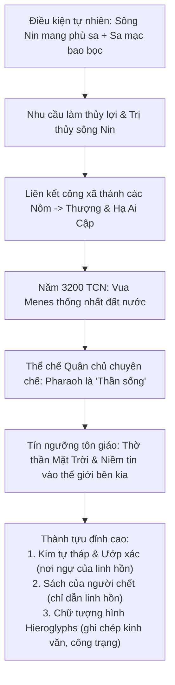

# BÀI HỌC: NỀN VĂN MINH AI CẬP CỔ ĐẠI
*(Tài liệu học tập & ôn tập Lịch sử 10 – Kết nối tri thức với cuộc sống)*

---

## PHẦN MỞ ĐẦU: KHÁI NIỆM VĂN HÓA VÀ VĂN MINH
* **Khái niệm Văn hóa:** Là tổng thể những giá trị vật chất và tinh thần do con người sáng tạo ra trong quá trình lịch sử.
* **Khái niệm Văn minh:** Là trạng thái phát triển cao về vật chất và tinh thần của xã hội loài người, thể hiện ở trình độ phát triển của kinh tế, chính trị, văn hóa, khoa học – kĩ thuật và tổ chức xã hội (khi xã hội loài người vượt qua thời kì dã man).
* **Phân biệt:** Văn hóa nhấn mạnh vào các giá trị do con người sáng tạo ra trong tiến trình lịch sử, còn văn minh nhấn mạnh vào **trình độ phát triển cao** của xã hội.

---

## I. CƠ SỞ HÌNH THÀNH VÀ TIẾN TRÌNH LỊCH SỬ

### 1. Vị trí địa lí và Điều kiện tự nhiên
* **Địa bàn:** Nằm ở khu vực Đông Bắc châu Phi, trải dài dọc theo lưu vực hạ lưu sông Nin (Nile).
* **Ranh giới thiên nhiên:**
  - *Phía Bắc:* Giáp Địa Trung Hải.
  - *Phía Đông:* Giáp Hồng Hải (Biển Đỏ).
  - *Phía Tây:* Giáp sa mạc Sahara.
  - *Phía Nam:* Giáp vùng rừng núi, thác nước hiểm trở.
* **Đặc điểm & Vai trò của sông Nin:**
  - Vị trí tương đối cô lập bởi sa mạc và biển bao bọc giúp bảo vệ Ai Cập khỏi các cuộc xâm lược từ bên ngoài trong các giai đoạn đầu.
  - Sông Nin đóng vai trò quyết định đối với sự sống và sự phát triển của Ai Cập cổ đại, là tuyến giao thông đường thủy huyết mạch.
  - Hằng năm, lũ sông Nin dâng mang theo lượng phù sa màu mỡ bồi đắp nên những đồng bằng trù phú, tạo điều kiện thuận lợi cho nông nghiệp phát triển.
  - $\rightarrow$ Nhà sử học Hê-rô-đốt (Herodotus) đã đúc kết: *"Ai Cập là quà tặng của sông Nin"*.

### 2. Lịch sử hình thành và các giai đoạn phát triển chính
* **Cơ sở hình thành (Khoảng cuối thiên niên kỉ IV TCN):** Do nhu cầu làm thủy lợi và trị thủy sông Nin, các công xã nông thôn liên kết thành các tiểu quốc sơ khai gọi là các **Nôm**. Sau đó, các Nôm hợp nhất thành hai vương quốc lớn: **Thượng Ai Cập** (ở phía Nam) và **Hạ Ai Cập** (ở phía Bắc).
* **Quá trình thống nhất đất nước (Khoảng năm 3200 TCN):** Vua Mê-nét (Menes / Nam-mơ) đã đánh bại Hạ Ai Cập, thống nhất Thượng và Hạ Ai Cập thành một quốc gia tập quyền lớn, mở đầu thời kỳ trị vì của các triều đại pharaoh.
* **Các giai đoạn phát triển chính:**
  - *Tảo Vương quốc & Cổ Vương quốc (Khoảng 3200 – 2160 TCN):* Thời kỳ xây dựng các Kim tự tháp quy mô lớn (như Kim tự tháp Kê-ốp/Khufu).
  - *Trung Vương quốc (Khoảng 2040 – 1650 TCN):* Thời kỳ mở rộng lãnh thổ, đẩy mạnh phát triển thương mại và văn hóa.
  - *Tân Vương quốc (Khoảng 1550 – 1069 TCN):* Giai đoạn phát triển đỉnh cao, hùng mạnh nhất về quân sự và đế chế, bành trướng lãnh thổ sang vùng Tây Á.
  - *Thời kì Hậu kỳ (Khoảng 1069 – 30 TCN):* Ai Cập suy yếu, lần lượt bị các đế quốc bên ngoài (Assyria, Ba Tư, Hy Lạp) xâm lược. Đến năm 30 TCN, Ai Cập trở thành một tỉnh của Đế quốc La Mã, chính thức kết thúc thời kỳ cổ đại.

### 3. Thể chế chính trị và Cơ cấu xã hội
* **Mô hình nhà nước:** Thiết lập thể chế **Quân chủ chuyên chế trung ương tập quyền** mang tính chất thần quyền sâu sắc.
* **Quyền lực của Pha-ra-ông (Pharaoh):**
  - Đứng đầu nhà nước là Pha-ra-ông, nắm giữ toàn bộ quyền lực tối cao về chính trị, quân sự, luật pháp và tôn giáo.
  - Pha-ra-ông được tôn thờ như một vị thần sống (hiện thân của con thần Mặt Trời Re/Amon-Re) xuống trần gian để cai trị con người.
* **Bộ máy giúp việc và cơ cấu xã hội:**
  - *Tầng lớp thống trị:* Giúp việc cho Pha-ra-ông là lực lượng quan lại và tầng lớp tăng lữ (các đại tư tế) giữ vai trò then chốt trong quản lý nhà nước, thu thuế và tổ chức nghi lễ tôn giáo.
  - *Tầng lớp bị trị:* Chiếm đa số dân cư là nông dân công xã (lực lượng sản xuất chính), thợ thủ công, thương nhân và tầng lớp dưới đáy là nô lệ.

---

## II. NHỮNG THÀNH TỰU VĂN MINH TIÊU BIỂU

### 1. Chữ viết
* **Nguồn gốc và thời gian:** Ra đời khoảng từ năm 3300 – 3200 TCN, được người Ai Cập gọi là chữ **hieroglyphs** (chữ tượng hình hay *"những nét khắc linh thiêng"*) do thần Trí tuệ Thoth ban tặng.
* **Đặc điểm hệ thống:** Là sự kết hợp hài hòa giữa biểu tượng hình ảnh, ý niệm và âm thanh (gồm khoảng 1.000 ký tự, trong đó có hệ thống 24 chữ cái phụ âm).

### 2. Văn học
Văn học Ai Cập cổ đại phát triển phong phú, gắn bó mật thiết với thần thoại, tôn giáo và triết lý nhân sinh:
* **Thần thoại và tôn giáo:** Các bài ca ngợi thần linh; tiêu biểu nhất là ***Sách của người chết* (Book of the Dead)** – tập hợp các câu thần chú, nghi thức giúp linh hồn người mất vượt qua thử thách và sự phán xét ở thế giới bên kia.
* **Truyện kể và tiểu thuyết:** Tiêu biểu với các tác phẩm kinh điển:
  - *Chuyện hai anh em*.
  - *Truyện Sinuhe*.
  - *Truyện về chiếc rương của vua Khufu*.
* **Văn học giáo huấn / Truyện đạo lý:** Các tập châm ngôn, lời răn dạy từ cha cho con hoặc từ pharaoh cho quan cận thần về đạo đức, phép ứng xử và lối sống khôn ngoan trong xã hội.
* **Thơ ca và tự truyện:** Các bài thơ tình, thơ ca ngợi thiên nhiên, ca ngợi các pharaoh, cùng các bản khắc tự truyện trên tường lăng mộ ghi lại công trạng của giới quý tộc.

### 3. Kiến trúc và Điêu khắc
* **Kiến trúc:**
  - Ba loại hình tiêu biểu nhất: Cung điện, đền thờ và kim tự tháp.
  - Tiêu biểu là **quần thể kim tự tháp ở Ghi-da (Giza)** (với khoảng 138 kim tự tháp đã được phát hiện), là những công trình vĩ đại thể hiện sức lao động và tài năng xây dựng bậc thầy.
* **Điêu khắc:**
  - Các tác phẩm nổi tiếng thế giới: **Tượng Nhân sư (Sphinx)** ở Ghi-da, **tượng bán thân của hoàng hậu Nê-phéc-ti-ti (Nefertiti)**, và **nắp quan tài bằng vàng của pha-ra-ông Tu-tan-kha-mun (Tutankhamun)** với kĩ thuật chế tác cực kỳ tinh xảo.

---

## III. ĐÁNH GIÁ Ý NGHĨA LỊCH SỬ CỦA THÀNH TỰU
* Các thành tựu của văn minh Ai Cập cổ đại là **di sản vô giá của Ai Cập nói riêng và toàn thể nhân loại nói chung**.
* Đó là **hiện thân vĩ đại cho sức lao động kiên cường, trí tuệ uyên bác và khả năng sáng tạo phi thường** của con người trong thời kì cổ đại.

---

## IV. HOẠT ĐỘNG CỦNG CỐ & LUYỆN TẬP KIẾN THỨC

### 1. Bảng tóm tắt hệ thống kiến thức cốt lõi (Mindmap dạng bảng)

| Lĩnh vực | Nội dung then chốt cần ghi nhớ |
|:---|:---|
| **Khái niệm mở đầu** | - **Văn hóa:** Toàn bộ giá trị vật chất và tinh thần do con người sáng tạo ra trong lịch sử. - **Văn minh:** Trạng thái phát triển cao của xã hội loài người (kinh tế, chính trị, văn hóa, khoa học) khi vượt qua thời kỳ dã man. |
| **Cơ sở tự nhiên** | - Nằm ở Đông Bắc châu Phi, hạ lưu sông Nin. - Được bao bọc bởi sa mạc và biển $\rightarrow$ vị trí tương đối cô lập, an toàn trước ngoại xâm thời kỳ đầu. - Hê-rô-đốt: *"Ai Cập là quà tặng của sông Nin"* (phù sa, giao thông, nguồn sống). |
| **Tiến trình lịch sử** | - Cuối thiên niên kỷ IV TCN: Nhu cầu trị thủy $\rightarrow$ liên kết thành các **Nôm** $\rightarrow$ hình thành Thượng và Hạ Ai Cập. - Khoảng 3200 TCN: **Vua Menes** thống nhất Thượng và Hạ Ai Cập, lập nên vương triều đầu tiên. - Thời Cổ Vương quốc: Xây dựng các Kim tự tháp khổng lồ. - Năm 30 TCN: Trở thành một tỉnh của La Mã, kết thúc thời kỳ cổ đại. |
| **Chính trị & Xã hội** | - **Thể chế:** Quân chủ chuyên chế trung ương tập quyền mang tính thần quyền sâu sắc. - **Pharaoh:** Nắm trọn quyền lực tối cao (chính trị, quân sự, luật pháp, tôn giáo), được tôn thờ là "thần sống" (con thần Mặt Trời Ra). - **Cơ cấu xã hội:** Thống trị (Pharaoh, tăng lữ, quan lại) $\leftrightarrow$ Bị trị (Nông dân công xã là lực lượng sản xuất chính, thợ thủ công, thương nhân, nô lệ dưới đáy xã hội). |
| **Chữ viết** | - Chữ tượng hình (**Hieroglyphs** - *"những nét khắc linh thiêng"*), ra đời khoảng 3300 – 3200 TCN do thần Thoth ban tặng. - Kết hợp giữa hình ảnh, ý niệm và ngữ âm (gần 1.000 ký tự, 24 phụ âm). Viết trên đá, tường lăng mộ và giấy papyrus. |
| **Văn học** | - Gắn liền thần thoại và tôn giáo: Nổi tiếng nhất là ***Sách của người chết*** (Book of the Dead). - Truyện kể dân gian: *Chuyện hai anh em*, *Truyện Sinuhe*. - Văn học giáo huấn: Các tập châm ngôn, lời răn dạy đạo đức, phép ứng xử. |
| **Kiến trúc & Điêu khắc** | - **Kiến trúc:** Cung điện, đền thờ và kim tự tháp (tiêu biểu: Quần thể kim tự tháp Giza với tháp Khufu vĩ đại). - **Điêu khắc:** Tượng Nhân sư (Sphinx), tượng bán thân hoàng hậu Nefertiti, nắp quan tài bằng vàng của Tutankhamun. |

---

### 2. Sơ đồ chuỗi logic nhân quả (Logic Chain)

---

### 3. Câu hỏi củng cố & Rèn luyện tư duy phản biện (Tự luận trọng tâm)

* **Câu 1: Vì sao nhà sử học Hê-rô-đốt lại khẳng định "Ai Cập là quà tặng của sông Nin"?**
  - *Gợi ý trả lời:* Sông Nin không chỉ cung cấp nguồn nước ngọt và thủy sản dồi dào giữa vùng khí hậu sa mạc khô hạn, mà các đợt lũ hàng năm còn bồi đắp lớp phù sa màu mỡ vô tận tạo điều kiện cho nền nông nghiệp trồng trọt phát triển sớm. Ngoài ra, sông Nin là tuyến đường giao thông thủy độc đạo kết nối giao thương giữa Thượng và Hạ Ai Cập, thúc đẩy quá trình thống nhất quốc gia. Không có sông Nin, Ai Cập sẽ chỉ là một dải sa mạc hoang vu cằn cỗi.

* **Câu 2: Hãy chỉ ra mối quan hệ mật thiết giữa tín ngưỡng tôn giáo của người Ai Cập và các thành tựu về kiến trúc, điêu khắc, văn học.**
  - *Gợi ý trả lời:*
    - Người Ai Cập có quan niệm sâu sắc về sự bất tử của linh hồn: thể xác chết đi nhưng linh hồn (Ka và Ba) vẫn tồn tại và sẽ có ngày quay trở lại.
    - *Về kiến trúc & điêu khắc:* Thúc đẩy xây dựng các lăng mộ đá vĩnh cửu (Kim tự tháp) để bảo vệ thi thể, phát triển thuật ướp xác và điêu khắc tượng chân dung (tượng bán thân, mặt nạ vàng) để linh hồn nhận diện thể xác khi trở về.
    - *Về văn học:* Ra đời *Sách của người chết* cùng hàng loạt văn tự thần chú trên tường lăng mộ nhằm dẫn đường và bảo hộ linh hồn vượt qua phiên tòa phán xét của thần Anubis và thần Osiris.

* **Câu 3: Phân tích bản chất và nguồn gốc tính "thần quyền" trong quyền lực của Pha-ra-ông.**
  - *Gợi ý trả lời:* Pha-ra-ông không chỉ là một vị vua cai trị về mặt thế tục mà còn được thiêng liêng hóa thành hiện thân của thần linh (con thần Mặt Trời Ra). Việc gắn quyền lực chính trị với thần quyền giúp Pharaoh hợp thức hóa sự phục tùng tuyệt đối của dân chúng, tăng cường sự gắn kết xã hội và tập trung quyền lực tối cao trong việc điều hành các công trình trị thủy và xây dựng khổng lồ.

---

### 4. 10 Câu trắc nghiệm củng cố nhanh (Đánh giá mức độ nắm bài)

**Câu 1:** Nền văn minh Ai Cập cổ đại được hình thành ở khu vực nào?  
A. Tây Nam Á.  
B. Đông Bắc châu Phi.  
C. Nam Á.  
D. Đông Á.  
*(Đáp án: **B**)*

**Câu 2:** Sự kiện nào đánh dấu bước ngoặt thống nhất nhà nước Ai Cập cổ đại vào khoảng năm 3200 TCN?  
A. Vua Ramses II bành trướng lãnh thổ.  
B. Vua Menes đánh bại Hạ Ai Cập, lập nên vương triều đầu tiên.  
C. Hoàn thành quần thể kim tự tháp Giza.  
D. Đế quốc La Mã xâm lược Ai Cập.  
*(Đáp án: **B**)*

**Câu 3:** Đứng đầu nhà nước Ai Cập cổ đại nắm giữ toàn bộ quyền lực tối cao là ai?  
A. En-xi.  
B. Thiên tử.  
C. Pha-ra-ông.  
D. Ra-gia.  
*(Đáp án: **C**)*

**Câu 4:** Lực lượng giữ vai trò sản xuất chính trong xã hội Ai Cập cổ đại là:  
A. Tăng lữ, quý tộc.  
B. Nông dân công xã.  
C. Thương nhân.  
D. Nô lệ.  
*(Đáp án: **B**)*

**Câu 5:** Chữ viết của người Ai Cập cổ đại ban đầu là loại chữ gì?  
A. Chữ hình nêm (tiết vị).  
B. Chữ tượng hình (Hieroglyphs).  
C. Chữ cái La-tinh.  
D. Chữ Phạn.  
*(Đáp án: **B**)*

**Câu 6:** Vị thần nào trong thần thoại Ai Cập được coi là người ban tặng chữ viết cho con người?  
A. Thần Ra.  
B. Thần Osiris.  
C. Thần Anubis.  
D. Thần Thoth.  
*(Đáp án: **D**)*

**Câu 7:** Tác phẩm văn học tôn giáo nổi tiếng nhất ghi chép lại các câu thần chú dẫn lối cho linh hồn ở thế giới bên kia là:  
A. Sử thi Gilgamesh.  
B. Sách của người chết.  
C. Sử thi Ramayana.  
D. Truyện Sinuhe.  
*(Đáp án: **B**)*

**Câu 8:** Ba loại hình công trình kiến trúc tiêu biểu nhất của Ai Cập cổ đại là:  
A. Cung điện, đền thờ, kim tự tháp.  
B. Thành lũy, chùa tháp, cầu cống.  
C. Nhà hát, đấu trường, đền thờ.  
D. Vườn treo, cổng vòm, kim tự tháp.  
*(Đáp án: **A**)*

**Câu 9:** Kim tự tháp lớn nhất trong quần thể kim tự tháp Giza thuộc về vị vua nào?  
A. Menes.  
B. Tutankhamun.  
C. Khufu (Kê-ốp).  
D. Ramses II.  
*(Đáp án: **C**)*

**Câu 10:** Năm 30 TCN, sự kiện lịch sử nào đã chấm dứt thời kỳ lịch sử cổ đại của Ai Cập?  
A. Quân khởi nghĩa nông dân lật đổ Pharaoh.  
B. Ai Cập bị sáp nhập trở thành một tỉnh của Đế quốc La Mã.  
C. Các cuộc xâm lăng của người Ba Tư.  
D. Sông Nin cạn kiệt nguồn nước.  
*(Đáp án: **B**)*

---

### 5. Ghi nhớ một dòng (Key Takeaway)
> **Ai Cập cổ đại là nền văn minh nông nghiệp trù phú bên dòng sông Nin, mang bản chất nhà nước quân chủ thần quyền tuyệt đối, để lại cho nhân loại những di sản vĩ đại bất tử về chữ tượng hình, tôn giáo và nghệ thuật kiến trúc - điêu khắc đá đỉnh cao.**

---
*Tài liệu học tập Lịch sử 10 – Lưu hành nội bộ `idk-lop10`*

