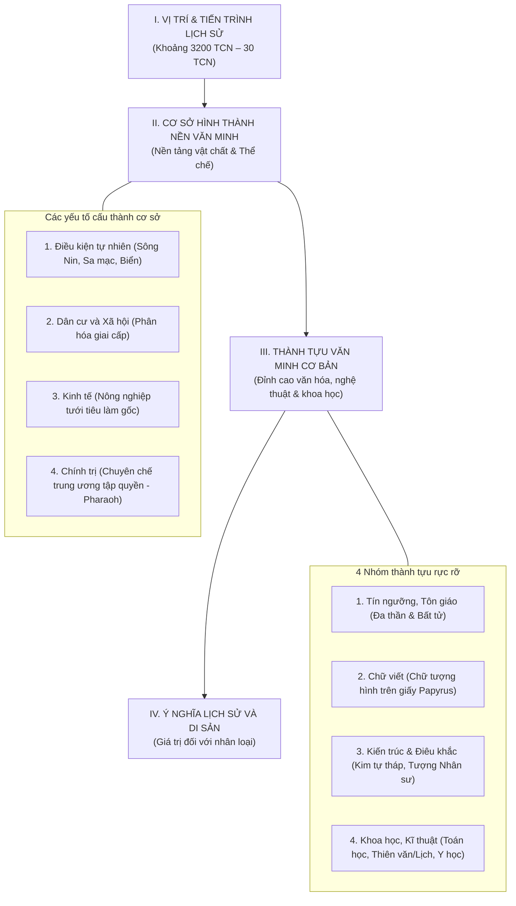

# PHÂN TÍCH CẤU TRÚC PHẦN "VĂN MINH AI CẬP CỔ ĐẠI"
### Môn: Lịch sử 10 – Bộ sách "Kết nối tri thức với cuộc sống"
- **Vị trí bài học:** Nằm trong **Chủ đề 3: Một số nền văn minh thế giới thời kì cổ – trung đại** (Bài 5 trong SGK trang 35 – 39; theo phân phối chương trình của nhiều trường được triển khai ở Bài 3 về các nền văn minh phương Đông).
- **Tài liệu tham chiếu:** `sach-giao-khoa-lich-su-10-ket-noi-tri-thuc-voi-cuoc-song.pdf` (Trang 35 đến 39).

---

## I. TỔNG QUAN VỀ MÔ HÌNH CẤU TRÚC SƯ PHẠM CỦA BÀI HỌC

Trong bộ sách Lịch sử 10 (Chương trình GDPT 2018), phần **Văn minh Ai Cập cổ đại** được thiết kế theo một **cấu trúc logic nhân quả, biện chứng và chuẩn mực của khoa học lịch sử**:



---

## II. PHÂN TÍCH CHI TIẾT TỪNG PHẦN TRONG CẤU TRÚC BÀI HỌC

---

### PHẦN 1: CƠ SỞ HÌNH THÀNH VĂN MINH AI CẬP CỔ ĐẠI (SGK trang 35 – 36)
> *Mục tiêu cấu trúc: Trả lời câu hỏi: **Nền văn minh ra đời ở đâu, khi nào, do ai tạo nên và dựa trên những điều kiện vật chất nào?***

Phần này gồm 4 nhánh tương hỗ, gắn kết mật thiết theo quan hệ nhân – quả:

#### 1. Điều kiện tự nhiên (Yếu tố quyết định không gian sinh tồn)
- **Vị trí địa lý:** Nằm ở vùng Đông Bắc châu Phi, được bao quanh bởi Địa Trung Hải (phía Bắc), Biển Đỏ/Hồng Hải (phía Đông), các sa mạc cát mênh mông (phía Tây) và rừng núi đá (phía Nam). Vị trí này tạo nên thế biệt lập tự nhiên, bảo vệ Ai Cập khỏi các cuộc xâm lược từ bên ngoài trong thời gian dài.
- **Vai trò cốt tử của sông Nin:** 
  - Là dòng sông dài nhất thế giới chảy từ Nam lên Bắc.
  - Hằng năm từ tháng 7 đến tháng 10, nước lũ dâng mang theo lớp phù sa đen màu mỡ bồi đắp hai bên bờ tạo nên dải đồng bằng hẹp phì nhiêu (*"Vùng đất đen" - Kemet*), đối lập hoàn toàn với sa mạc cằn cỗi xung quanh (*"Vùng đất đỏ" - Deshret*).
  - Cung cấp nguồn nước ngọt sinh hoạt, nguồn thủy sản và đóng vai trò như tuyến giao thông huyết mạch duy nhất kết nối toàn lãnh thổ.
  - $\rightarrow$ *Nhận định kinh điển của Herodotus:* **"Ai Cập là tặng phẩm của sông Nin"**.

#### 2. Dân cư và Xã hội (Chủ thể sáng tạo nền văn minh)
- **Thành phần dân cư:** Nằm ở ngã ba giao lưu giữa châu Á, châu Phi và châu Âu. Khoảng hơn 3000 năm TCN, các tộc người từ châu Phi (người Hamite) cùng các bộ tộc từ Palestine, Syria (người Semite) hội tụ tại hạ lưu sông Nin, hòa huyết và cùng nhau sáng tạo nên nền văn minh Ai Cập.
- **Cơ cấu phân hóa xã hội:** Hình thành mô hình xã hội có giai cấp điển hình phương Đông cổ đại:
  - *Tầng lớp thống trị:* **Pharaoh** (đứng đầu tối cao), quý tộc, tăng lữ (nắm giữ ruộng đất, của cải và độc quyền tôn giáo).
  - *Tầng lớp bị trị (Lực lượng sản xuất chính):* **Nông dân công xã** (đông đảo nhất, trực tiếp cày cấy và làm nghĩa vụ lao dịch xây kim tự tháp), thợ thủ công, thương nhân.
  - *Tầng lớp đáy cùng:* **Nô lệ** (tù binh chiến tranh hoặc nông dân phá sản, chuyên làm công việc nặng nhọc trong cung điện, đền đài).

#### 3. Kinh tế (Cơ sở vật chất nuôi dưỡng nền văn minh)
- **Nông nghiệp thủy lợi làm gốc:** Nền kinh tế hoàn toàn phụ thuộc vào nông nghiệp tưới tiêu phù sa sông Nin. Cây lương thực chính là lúa mì, lúa mạch, kê, đậu và lanh dệt vải.
- **Chăn nuôi gia súc:** Thuần dưỡng và chăn thả gia súc (bò, dê, cừu, lừa, ngựa...) để lấy sức kéo, thịt, sữa và phân bón.
- **Thủ công nghiệp & Thương mại:** Đúc đồng, làm gốm, dệt vải, đóng thuyền bè đi lại trên sông Nin, đặc biệt là nghề sản xuất **giấy Papyrus**. Hoạt động buôn bán, trao đổi sản vật diễn ra tấp nập dọc lưu vực sông và mở rộng sang Tây Á.

#### 4. Chính trị (Bộ máy tổ chức quyền lực nhà nước)
- **Quá trình hình thành nhà nước:** 
  - Ban đầu, nhu cầu trị thủy sông Nin buộc các công xã phải liên kết lại thành các tiểu quốc nông thôn độc lập gọi là **nôm** (nome).
  - Đến khoảng **năm 3200 TCN**, vua Menes (Narmer) đã đánh bại các nôm đối thủ, thống nhất Thượng Ai Cập và Hạ Ai Cập, lập nên Nhà nước Ai Cập thống nhất (ghi lại trên tấm bia đá Narmer).
- **Thể chế chính trị:** Thiết lập mô hình **Nhà nước quân chủ chuyên chế trung ương tập quyền cao độ**:
  - Đứng đầu là **Pharaoh** (pha-ra-ông): nắm giữ quyền lực tối thượng tuyệt đối cả về thế quyền (chính trị, quân sự, luật pháp) lẫn thần quyền (được tôn xưng là con của thần Mặt Trời Ra, hiện thân của thần Horus dưới trần gian).
  - Giúp việc cho Pharaoh là chức Tể tướng (Vizier) và hệ thống quan lại, tăng lữ quản lý từ trung ương xuống địa phương.

---

### PHẦN 2: NHỮNG THÀNH TỰU VĂN MINH CƠ BẢN (SGK trang 36 – 39)
> *Mục tiêu cấu trúc: Trả lời câu hỏi: **Cư dân Ai Cập cổ đại đã để lại những di sản tinh thần và vật chất kỳ vĩ nào cho hậu thế?***

SGK phân loại các thành tựu theo 4 lĩnh vực cốt lõi có mối liên hệ nội tại chặt chẽ:

#### 1. Tín ngưỡng và Tôn giáo (Thế giới quan chi phối mọi mặt đời sống)
- **Tín ngưỡng sùng bái đa thần:** Thờ phụng hàng trăm vị thần:
  - *Thần tự nhiên:* Thần Mặt Trời (Ra/Amon-Ra – vị thần tối cao), thần sông Nin (Hapi), thần Mặt Trăng (Thoth), thần Bầu trời (Nut)...
  - *Thần động vật:* Thần chim ưng (Horus), rắn hổ mang, thần chó rừng (Anubis)...
- **Niềm tin vào sự bất tử của linh hồn:** 
  - Người Ai Cập tin rằng thể xác chết đi nhưng linh hồn (*Ka*) vẫn tồn tại. Linh hồn sẽ đi xuống thế giới ngầm của thần Osiris (thần cai quản cái chết và phục sinh) để chịu sự phán xét: thần Anubis đặt quả tim người chết lên chiếc cân đối trọng với chiếc lông vũ của nữ thần chân lý Ma'at (*Hình 2 - Sách của người chết*).
  - Nếu tim nhẹ hoặc cân bằng với chiếc lông vũ thì người đó trong sạch và được sống đời đời; nếu nặng hơn do tội lỗi thì bị quái vật Ammit nuốt chửng.
- **Tác động kiến tạo văn minh:** Niềm tin bất tử chính là nguồn gốc trực tiếp thúc đẩy sự ra đời của **kỹ thuật ướp xác** (giữ nguyên vẹn thể xác để linh hồn trú ngụ) và **nghệ thuật xây dựng lăng mộ khổng lồ (Kim tự tháp)**.

#### 2. Chữ viết (Phương tiện ghi chép và lưu giữ văn minh)
- **Hệ thống chữ tượng hình (Hieroglyphics):**
  - Ra đời từ khoảng **hơn 3000 năm TCN**, là một trong những hệ thống chữ viết cổ xưa nhất của nhân loại.
  - Ban đầu là những hình vẽ mô phỏng trực quan con người, con vật, cây cối, đồ vật; về sau bổ sung các ký hiệu biểu thị âm thanh và ý niệm trừu tượng.
- **Chất liệu viết độc đáo – Giấy Papyrus:**
  - Tận dụng thân cây cói papyrus mọc bạt ngàn ven bờ sông Nin, người Ai Cập cắt mỏng, đan chéo, ép chặt và phơi khô tạo thành những cuộn giấy nhẹ, dai và bền. Dùng bút sậy chấm mực đen (pha từ bồ hóng) và mực đỏ để viết.
- **Ý nghĩa & Giải mã:**
  - Chữ viết giúp người Ai Cập ghi chép lại các văn bản tôn giáo (*Sách của người chết*), hồ sơ hành chính, lịch sử, văn học và các công thức toán học, y học.
  - Chữ tượng hình Ai Cập là cội nguồn để người Phoenicia sáng tạo bảng chữ cái âm vị (nguồn gốc bảng chữ cái La-tinh ngày nay).
  - Năm 1822, nhà ngôn ngữ học người Pháp **Jean-François Champollion** đã giải mã thành công chữ tượng hình nhờ bản dịch đối chiếu trên **Bia đá Rosetta** (niên đại 196 TCN).

#### 3. Kiến trúc và Điêu khắc (Đỉnh cao của nghệ thuật tạo hình & kỹ thuật xây dựng)
- **Kiến trúc lăng mộ – Kim tự tháp (Pyramid):**
  - Đã phát hiện khoảng 138 kim tự tháp tại Ai Cập.
  - Tiêu biểu nhất là **Quần thể kim tự tháp Giza** (thế kỉ XXVI TCN), với **Kim tự tháp Kê-ốp (Khufu)** là công trình vĩ đại nhất: cao 147m (nguyên bản), xây dựng từ hơn 2,3 triệu khối đá vôi lớn (mỗi khối nặng trung bình 2,5 – 5 tấn) được ghè đẽo và ghép khít khao đến mức một mũi dao cũng không lọt qua.
  - Kim tự tháp là biểu tượng tuyệt đối cho uy quyền vô hạn của Pharaoh và sức sáng tạo, năng lực tổ chức lao động phi thường của người Ai Cập cổ đại.
- **Kiến trúc đền thờ:** Các quần thể đền thờ thần linh khổng lồ như Karnak, Luxor với những hàng cột đá cao vút chạm khắc tinh xảo.
- **Nghệ thuật điêu khắc:**
  - **Tượng Nhân sư (Sphinx) ở Giza:** Tạc nguyên khối từ núi đá tự nhiên với thân sư tử (sức mạnh thể chất) và đầu người mang gương mặt Pharaoh Khafre (trí tuệ và uy quyền).
  - **Tượng bán thân hoàng hậu Nefertiti:** Đạt đỉnh cao vẻ đẹp thanh thoát, sống động.
  - **Nắp quan tài và mặt nạ vàng của Pharaoh Tutankhamun:** Tinh xảo tuyệt mỹ, thể hiện trình độ luyện kim và kim hoàn bậc thầy.

#### 4. Khoa học và Kỹ thuật (Đóng góp mang tính nền tảng cho nhân loại)
- **Toán học:**
  - Sử dụng **hệ đếm thập phân** (cơ số 10), thực hiện thành thạo các phép tính cộng, trừ (nhân chia bằng cách nhân đôi liên tiếp).
  - Tính được chính xác diện tích hình tam giác, hình chữ nhật, hình thang và diện tích hình tròn; biết tính thể tích hình chóp cụt.
  - Tính được số $\mathbf{\pi \approx 3,16}$ (rất gần với giá trị thực tế 3,14).
  - *Nguồn gốc:* Xuất phát hoàn toàn từ nhu cầu thực tiễn: đo đạc lại ranh giới ruộng đất sau mỗi đợt lũ sông Nin rút, và tính toán vật liệu xây dựng kim tự tháp, đền đài.
- **Thiên văn học và Lịch pháp:**
  - Nhờ bầu trời đêm sa mạc trong vắt, người Ai Cập sớm quan sát chuyển động của các chòm sao. Họ phát hiện chu kỳ ngôi sao Thiên Lang (Sirius) mọc cùng lúc với Mặt Trời vào buổi rạng đông cũng là lúc nước sông Nin bắt đầu dâng lũ.
  - Từ đó sáng tạo ra **Nông lịch (Dương lịch sơ khai)**: 1 năm có 365 ngày, chia làm 12 tháng (mỗi tháng 30 ngày) và cộng thêm 5 ngày lễ hội cuối năm; chia 1 năm làm 3 mùa (mùa Lũ lụt, mùa Gieo hạt, mùa Thu hoạch).
- **Y học và Giải phẫu học:**
  - Thông qua tục ướp xác, người Ai Cập có cơ hội mổ xẻ nội tạng và hiểu biết chính xác về cấu trúc giải phẫu học cơ thể người, hệ tuần hoàn máu và các cơ quan nội tạng (tim, gan, phổi, não...).
  - Họ đã biết chẩn đoán bệnh qua bắt mạch, dùng thảo dược chữa bệnh, thực hiện các ca phẫu thuật sọ não, xương khớp và chế tạo nhiều dụng cụ y tế chuyên dụng bằng kim loại.

---

## III. MỐI QUAN HỆ BIỆN CHỨNG NỘI TẠI TRONG CẤU TRÚC BÀI HỌC

Điểm xuất sắc nhất trong cấu trúc bài giảng về văn minh Ai Cập cổ đại là **mối liên hệ hữu cơ, dây chuyền giữa các yếu tố**:

```
[Điều kiện tự nhiên: Sông Nin lũ lụt]
       │
       ├──> Cần trị thủy, đắp đê ──> Hình thành nhà nước tập quyền (Pharaoh)
       │
       ├──> Xóa nhòa bờ cõi ruộng đất ──> Phát triển TOÁN HỌC (Hình học)
       │
       └──> Quan sát nước lũ theo sao Sirius ──> Phát triển THIÊN VĂN & LỊCH PHÁP

[Tín ngưỡng tôn giáo: Niềm tin linh hồn bất tử]
       │
       ├──> Muốn bảo vệ thể xác ──> Phát minh KỸ THUẬT ƯỚP XÁC ──> Phát triển Y HỌC & GIẢI PHẪU
       │
       └──> Nơi trú ngụ vĩnh hằng cho Pharaoh ──> Xây dựng KIM TỰ THÁP ──> Phát triển KIẾN TRÚC & ĐIÊU KHẮC
```

---

## IV. BẢNG TỔNG KẾT CẤU TRÚC ĐỐI CHIẾU NHANH

| Mục cấu trúc | Nội dung cốt lõi | Biểu hiện / Thành tựu tiêu biểu | Ý nghĩa / Giá trị cốt lõi |
| :--- | :--- | :--- | :--- |
| **Không gian & Thời gian** | Đông Bắc châu Phi, lưu vực hạ lưu sông Nin; tồn tại từ k. 3200 TCN – 30 TCN. | Thống nhất Thượng và Hạ Ai Cập; thủ đô Memphis, Thebes. | Một trong những nền văn minh cổ xưa và trường tồn nhất lịch sử. |
| **Cơ sở tự nhiên** | Sông Nin bồi đắp phù sa; bao bọc bởi sa mạc và biển. | "Vùng đất đen" phì nhiêu; Herodotus: *"Ai Cập là tặng phẩm của sông Nin"*. | Cung cấp nguồn sống, giao thông và bảo vệ tự nhiên khỏi ngoại xâm. |
| **Cơ sở xã hội & Kinh tế** | Xã hội phân hóa giai cấp; kinh tế nông nghiệp tưới tiêu làm nền tảng. | Quý tộc, Tăng lữ, Nông dân công xã, Thợ thủ công, Nô lệ; lúa mì, giấy papyrus. | Tạo ra thặng dư của cải nuôi sống bộ máy nhà nước và phục vụ xây cất lăng mộ. |
| **Thể chế chính trị** | Quân chủ chuyên chế trung ương tập quyền cao độ. | Vua Pharaoh nắm cả vương quyền và thần quyền (con thần Mặt Trời Ra). | Tập trung tối đa nhân lực và của cải để thực hiện các công trình thế kỷ. |
| **Thành tựu Tôn giáo** | Đa thần giáo; niềm tin bất tử của linh hồn. | Thần Ra, Osiris, Anubis; Sách của người chết; tục ướp xác. | Nền tảng tâm linh chi phối toàn bộ kiến trúc, nghệ thuật và y học. |
| **Thành tựu Chữ viết** | Chữ tượng hình (Hieroglyphics); viết trên giấy Papyrus. | Sáng tạo từ > 3000 TCN; Bia đá Rosetta; Champollion giải mã năm 1822. | Lưu giữ kho tàng tri thức; tiền đề cho bảng chữ cái Phoenicia và La-tinh. |
| **Thành tựu Kiến trúc** | Xây dựng lăng mộ đá và đền đài đồ sộ. | 138 kim tự tháp (quần thể Giza, kim tự tháp Khufu); Tượng Nhân sư (Sphinx). | Biểu tượng trường tồn cho trí tuệ và sức mạnh lao động của con người. |
| **Thành tựu Khoa học** | Toán học, Thiên văn học, Lịch pháp và Y học. | Hệ đếm cơ số 10; số $\pi \approx 3,16$; Dương lịch 365 ngày; phẫu thuật và ướp xác. | Đặt nền móng ban đầu cho nền khoa học thực nghiệm của nhân loại. |

---
*Tài liệu phân tích chuyên đề Lịch sử 10 – Lưu hành nội bộ `idk-lop10`*
